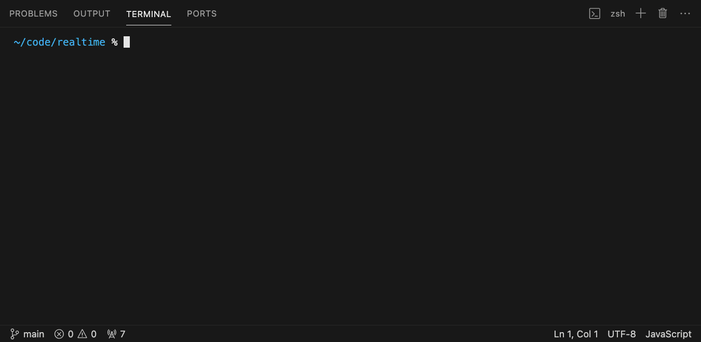
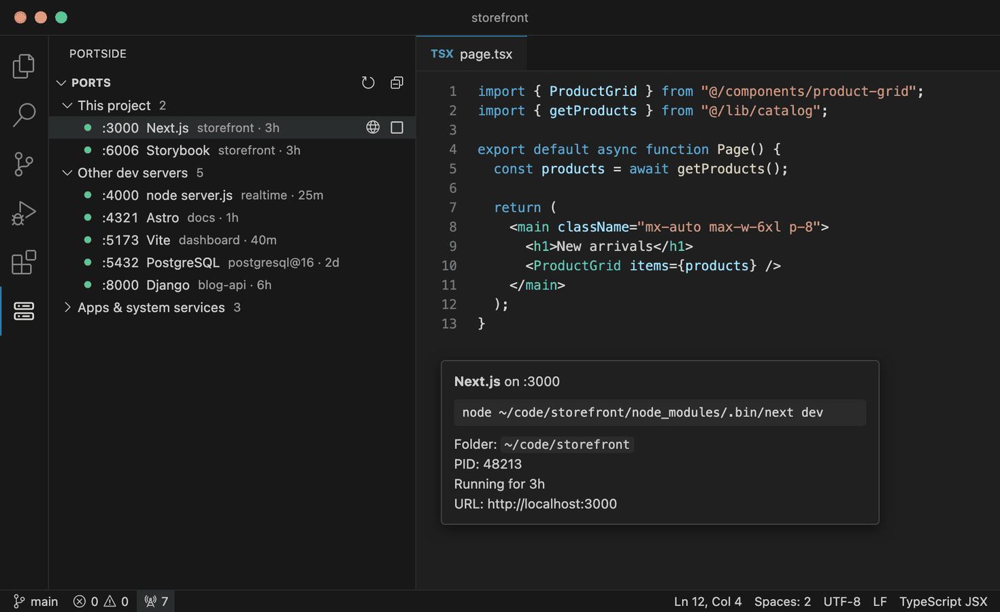

# Portside: Kill Port & Manage Dev Servers

**`Error: listen EADDRINUSE: address already in use :::3000`? Portside tells you what's using the port and stops it in one click.**

No more `lsof -i :3000`, no more `kill -9`, no more hunting for the terminal you forgot was running a server.

## See every dev server on localhost

- **Everything listening on localhost, in one sidebar.** Each server shows its port, a name you recognize (Next.js, Vite, Astro, Storybook, Django, Uvicorn, Rails, PostgreSQL, Redis…), the project folder that started it, and how long it has been running.
- **Grouped the way you think.** Servers from the project you have open come first, then other dev servers. Apps and system services stay out of the way.
- **One-click actions.** Open in the browser, copy the URL, reveal the project folder, stop, or force kill. Hover a server for its full command, folder and PID.
- **A live count in the status bar.** Click it for a quick list of running dev servers.

## Fixes "port already in use" where it happens

When a command in the VS Code terminal fails because its port is taken, Portside names what holds the port, which project started it and for how long, and offers **Stop It**. Once the port is free, **Run Again** reruns your command in the same terminal. It recognizes the errors from Node, Next.js, Vite, Astro, Create React App, Django, Uvicorn, Go, Rails and more.

Want zero clicks? Turn on `portside.autoFreePortsFromThisProject` and stale servers from the project you have open are stopped automatically. Servers from other projects always ask first.

**It knows Docker.** A port published by a container shows the container's name and image, and Stop runs `docker stop`. Works with Docker Desktop, OrbStack, Colima, Rancher Desktop and Podman.

**It stops the whole dev server.** Stopping a server started with `npm run dev` ends the whole job (npm, node and the server), so it doesn't restart itself. Shells and VS Code itself are never touched.

**It knows the macOS AirPlay trap.** Ports 5000 and 7000 belong to macOS AirPlay Receiver. Portside says so and links to the setting instead of offering to kill a system process.

## Portside vs. doing it by hand

| | By hand | With Portside |
| --- | --- | --- |
| Find what's on a port | `lsof -i :3000`, read a PID | Look at the sidebar |
| Know which project it is | `ps`, `lsof -p <pid> -d cwd` | Shown next to the port |
| Stop it | `kill <pid>`, then `kill -9` | **Stop It** |
| Stop `npm run dev` cleanly | Find the parent npm process too | Stops the whole job |
| Port held by Docker | `docker ps`, match the port, `docker stop` | Shows the container; Stop stops it |
| Run the command again | Scroll up, copy, paste | **Run Again** |
| Port 5000 taken on a Mac | Search why | Told it's AirPlay Receiver |

## Commands

| Command | What it does |
| --- | --- |
| `Portside: Show Running Dev Servers` | Quick list of dev servers; select one to open it, or use the stop button |
| `Portside: Stop Whatever Is Using a Port...` | Type a port number and stop what's on it |
| `Portside: Stop All Servers in This Project` | Stop every server started from the open project (also a button in the sidebar) |
| `Portside: Stop All Dev Servers` | End-of-day cleanup: stop every dev server, after confirming |
| `Portside: Refresh` | Check ports now |

## Settings

| Setting | Default | Description |
| --- | --- | --- |
| `portside.refreshInterval` | `5` | Seconds between checks while VS Code is focused |
| `portside.showStatusBar` | `true` | Show the dev server count in the status bar |
| `portside.detectPortConflicts` | `true` | Offer to free a port when a terminal reports it is in use |
| `portside.autoFreePortsFromThisProject` | `false` | Stop stale servers from the open project without asking, then offer Run Again |

## Requirements

- **macOS and Linux:** uses `lsof` (or `ss` on Linux), which are installed on almost every system.
- **Windows:** uses `netstat` and PowerShell.
- **Remote (SSH, WSL, Dev Containers):** Portside runs where your code runs and lists that machine's ports. Open in Browser forwards the port for you.
- Tested on every change on macOS, Linux and Windows, including real servers and a real Docker container.
- Port-conflict detection reads terminal output through VS Code's shell integration, which is on by default for bash, zsh, fish and PowerShell.

Portside only lists processes your user account can see, never sends anything over the network, and collects no telemetry.

## Try it without your own projects

Clone the repo and run `npm run demo`. It starts small local servers laid out like Next.js, Storybook, Vite, Astro, Django and a Node API project, so you can see the sidebar and the Stop button in action. Press Ctrl-C to stop them.

## Contributing

Bug reports and ideas are welcome in [GitHub issues](https://github.com/divyanshus2404/portside/issues). Run `npm test` before sending a pull request.

## License

[MIT](LICENSE)
