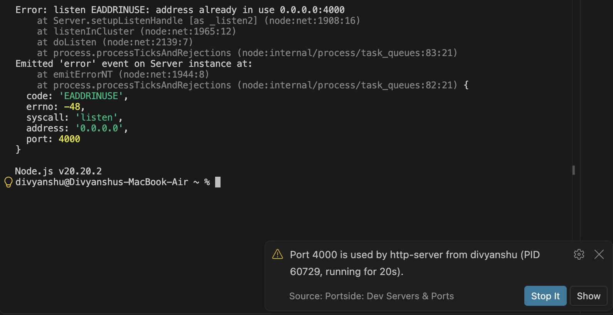

# Portside: Dev Servers & Ports

**See every dev server running on localhost, which project started it, and stop it in one click.**

No more `Error: listen EADDRINUSE: address already in use :::3000`, no more searching for `lsof -i :3000` and `kill -9`.

## Features

- **Everything listening on localhost, in one sidebar.** Each server shows its port, a readable name (Next.js, Vite, Django, Uvicorn, PostgreSQL, Redis…), the project folder that started it, and how long it has been running.
- **Grouped the way you think.** Servers from the project you have open come first, then other dev servers, then apps and system services (collapsed).
- **One-click actions.** Open in the browser, copy the URL, reveal the project folder, stop, or force kill.
- **Fixes "port already in use" where it happens.** When a terminal command fails because a port is taken, Portside tells you what is using it (for example *"Port 3000 is used by Next.js from my-app, running for 2h"*) and offers to stop it.
- **Stops the whole dev server.** Stopping a server started with `npm run dev` ends the whole job (npm, node and the server), so it doesn't restart itself. Shells and VS Code itself are never touched.
- **Knows the macOS AirPlay trap.** Ports 5000 and 7000 are taken by macOS AirPlay Receiver. Portside says so and links to the setting instead of offering to kill a system process.
- **Status bar count** of running dev servers. Click it for a quick list.

## Commands

| Command | What it does |
| --- | --- |
| `Portside: Show Running Dev Servers` | Quick list of dev servers; select one to open it, or use the stop button |
| `Portside: Stop Whatever Is Using a Port...` | Type a port number and stop what's on it |
| `Portside: Refresh` | Check ports now |

## Settings

| Setting | Default | Description |
| --- | --- | --- |
| `portside.refreshInterval` | `5` | Seconds between checks while VS Code is focused |
| `portside.showStatusBar` | `true` | Show the dev server count in the status bar |
| `portside.detectPortConflicts` | `true` | Offer to free a port when a terminal reports it is in use |

## Requirements

- **macOS and Linux:** uses `lsof` (or `ss` on Linux), which are installed on almost every system.
- **Windows:** uses `netstat` and PowerShell.
- Port-conflict detection reads terminal output through VS Code's shell integration, which is on by default for bash, zsh, fish and PowerShell.

Portside only lists processes your user account can see, and never sends anything over the network.

## License

[MIT](LICENSE)
